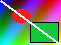

# Images

Every case below should show a picture or, where it says so, the alt text.

## Inline

An inline image with a title (hover it) sits in a line of text:  and the text goes on after it.

A PNG , a JPEG , a BMP  and an SVG badge  in one paragraph.

## Reference style

Full ![full ref][a], collapsed ![collapsed][], shortcut ![shortcut] and one with no definition ![nothing here][nope].

[a]: images/png_rgb8.png "Reference title"
[collapsed]: images/gif_trans.gif
[shortcut]: images/png_pal8.png

## Inside links

## Animated

A GIF that loops forever: 

A GIF that plays once: 

An animated PNG: 

## Scaling

This SVG is 1600 wide and scales down to the window, resize it to see it follow:

A small image is never scaled up: 

## Fallbacks

A file that does not exist: 

A remote image that cannot load: 

A plain http source is never fetched: 

A broken link-wrapped image: 

## In containers

| Picture | Name |
| --- | --- |
|  | gif |
|  | png |

- A list item with 
- Another with 

> A quote with 

### A heading with an image 
